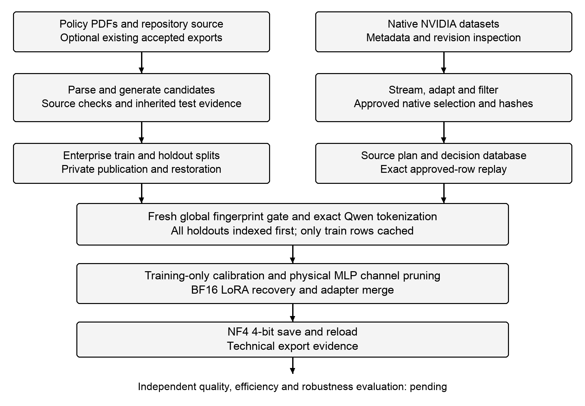
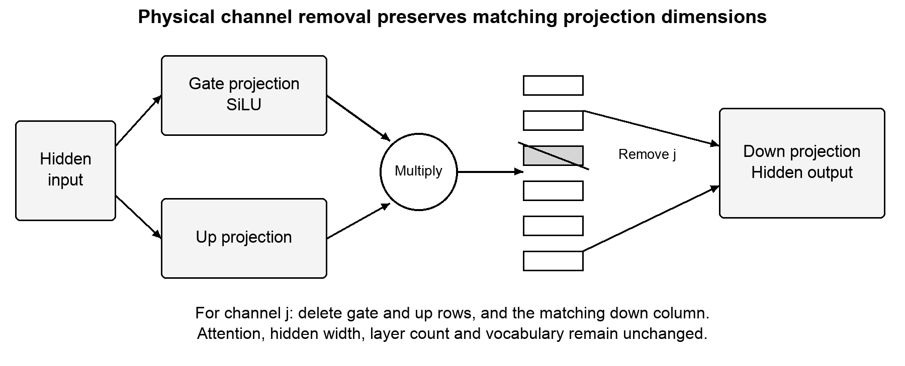

# 1 Introduction

## 1.1 Problem and purpose

A software engineering team needs an assistant that can produce useful code while answering a limited set of questions about its own operating rules. Public coding datasets can support programming adaptation, but they do not describe an organisation's approval conditions, exceptions or internal terminology. Corporate documents supply that context in formats that are difficult to use directly for supervised training. Repository code presents a second difficulty: a function's behaviour often depends on imports, surrounding declarations and tests outside the function itself.

This project develops a Python framework that prepares these sources for Qwen3-14B and runs a bounded compression and adaptation experiment. The immediate research priority is improvement on coding tasks, supported by NVIDIA OpenCodeInstruct, together with evidence that a smaller corporate dataset can be included and learned. Parameter reduction and 4-bit export are engineering objectives whose effect on quality must be measured. The model family and its thinking and non-thinking modes are described in the Qwen3 technical report [1].

The dissertation retains the approved title, Bridging the Chasm: A Tri-Phase Framework for Enterprise AI (Corporate Data Transformation, Tuning for Compliance, and Robustness Auditing). Its three phases are data transformation, model adaptation and compression, and subsequent evaluation and robustness auditing. The implementation now reaches a technically verified 14B export in a short experiment. The larger coding-focused run and the final assessment are separate pieces of evidence.

## 1.2 Research questions and scope

The work asks whether heterogeneous policy and repository material can be converted into traceable conversational records; whether those records can be combined with a reproducible external coding selection; and whether a structurally smaller, adapted, quantized model can improve coding performance while retaining useful answers about the organisation. The first two questions have implementation and integration evidence. The learning and robustness questions remain open until independent evaluation is completed.

The source collection contains ten synthetic policy PDFs and two supplied repository archives. The implemented data paths also support Markdown and text. The training target is the dense Qwen3-14B model. Linux with one NVIDIA CUDA device is the execution environment for pruning, recovery training and export. A cloud GPU was used for the observed experiment. Model training from scratch, legal compliance certification and enterprise-wide production deployment are outside the current scope.

## 1.3 Contribution and evidence boundary

The current contribution is an application framework with source-aware data preparation, inherited verification labels, immutable source selection, guarded training inputs and resumable model stages. Technical success means the stated stages ran and their artifacts could be checked. It does not establish improved code correctness, reliable policy compliance or resistance to attacks. Chapter 7 separates completed runs from an unfinished larger run. Chapter 8 records the measurements still required. Report organisation and presentation follow the supplied institutional guidelines [2] and final-report checklist [3].

# 2 Related work and research scope

## 2.1 Enterprise adaptation and the research gap

The project addresses two connected requirements: programming assistance and answers about a limited set of corporate rules. A public coding dataset supplies examples of programming tasks, while corporate documents and repository sources provide organisation-specific material. Their different origins require explicit source metadata, compatible conversation records and separate evidence about correctness.

The research questions concern whether these inputs can be prepared reproducibly, whether limited structural reduction can be followed by recovery training and a reloadable 4-bit export, and how the resulting model performs against the original Qwen3-14B. The current implementation provides processing and execution evidence. Independent coding and policy measurements are still required to answer the performance questions.

The literature below supports the choice of instruction data, adaptation methods and evaluation criteria. Published outcomes are attributed to their original studies; their transfer to this project's data and model remains an experimental question.

## 2.2 Coding instruction data and functional evaluation

OpenCodeInstruct contains programming instructions, solutions, tests and recorded assessment fields. Its technical report describes dataset construction and coding evaluations across several model families [4]. These results support investigating the dataset as a training source. They do not establish that every accepted row is correct or that the current Qwen experiment will improve. Externally supplied test results remain externally reported evidence in this framework.

Nemotron-Cascade-2-SFT-Data contains several domains. The configuration used in the initial integration was chat, while OpenCodeInstruct supplied specialised coding examples [5]. The larger experiment selects OpenCodeInstruct alone as its external source so that the programming-data contribution is easier to describe. General chat records are not relabelled as coding records.

HumanEval measures functional code generation through executable tests [6]. MBPP provides another source of short programming tasks and tests [7]. They offer candidate evaluation methods, subject to contamination checks and fixed test selection. Text similarity or a plausible explanation cannot substitute for correct execution.

## 2.3 Adaptation and model compression

LoRA freezes base weights and learns low-rank updates, reducing the parameters that need gradient and optimizer state [8]. QLoRA combines low-rank adaptation with a quantized training base [9]. Neither method by itself removes the base model's structural dimensions. The present implementation uses BF16 LoRA after physical MLP channel removal, then creates a separate NF4 export.

Research on compact language models combines structural pruning with recovery training and knowledge distillation [10]. Those methods can reduce model size, but their data budgets and measured quality do not transfer automatically to this experiment. Here the pruning method is deliberately narrow: it changes gated-MLP intermediate channels and preserves attention and residual dimensions. Teacher distillation has not been implemented.

Bitsandbytes supplies 4-bit linear layers integrated with Transformers [11]. Quantization reduces representation precision; pruning reduces selected dimensions. Their effects on disk size, active memory and latency must be reported separately. Some tensors remain at higher precision even in a nominal 4-bit checkpoint.

## 2.4 Enterprise rules and robustness

Policy answers require conditions and exceptions as well as a rule's main clause. A response that omits an approval exception can be wrong despite containing an exact quotation. The data workflow therefore combines source identity and passage checks with a separate model-assisted review. Because the reviewer shares the configured model, correlated errors remain a limitation.

Indirect prompt injection research shows that retrieved or supplied text can influence an LLM in unintended ways [12]. OWASP's LLM application risks provide a useful organising vocabulary for later security tests [13]. These references motivate a test plan; they do not certify the current model. The proposed robustness audit remains incomplete.

# 3 Research method and system architecture

## 3.1 Development method

The project follows an incremental engineering method. Each data stage has a typed contract, small synthetic tests and separate real integration evidence. Invalid input and interrupted processing remain visible in reports. Existing coding exports can be reused without regenerating expensive examples. Subsequent preparation and transport steps revalidate their contents and preserve the producer's completion status.

The Python package uses a src layout managed by uv. Pydantic Settings separates validated configuration from credentials. Typer exposes automation commands, while Rich and Questionary provide an interactive terminal interface. LangChain connects policy and code generation to the configured chat endpoint. LangGraph coordinates the data and model stages [14]. File and SQLite checkpoints provide durable decisions; large documents, conversations and tensors are not placed directly in graph state.

## 3.2 End-to-end flow

Figure 3.1 shows the implemented route. The enterprise branch parses policy documents or repository source, generates candidates and applies source-specific validation. Accepted inputs are combined in a shared schema and prepared into isolated splits. The external branch inspects NVIDIA metadata, selects native records and records approved coordinates. A fresh cross-source gate precedes token caching, calibration, pruning and recovery training.



Figure 3.1 Implemented workflow with the remaining evaluation boundary

The current user-facing flow consists of enterprise extraction or import, enterprise validation or restoration, NVIDIA preparation, native-selection validation, and Linux model compression. Earlier pipeline numbers remain compatibility interfaces. Final splitting logic was moved into enterprise preparation, so a separate manual Pipeline 4 invocation is no longer mandatory. The distinction is architectural: working validation algorithms were retained while redundant operator steps were removed.

## 3.3 Traceability and recovery

Records retain document or repository references and original source hashes. Remote sources carry dataset, configuration, split and revision information. Run fingerprints bind the relevant inputs, settings, implementation and dependency versions. File checksums and recorded counts provide a way to detect mutation rather than trusting a folder name.

Writes are committed at explicit boundaries. A failed run can contain useful accepted records, but its producer status remains failed or incomplete. Reuse of its validated subset requires explicit consent. Resume reuses completed work when the fingerprint matches; a change that affects interpretation selects a new run or is refused. Atomic file writes do not make every directory update a single transaction, so consumers also check final reports and hashes.

## 3.4 Confidentiality and reproducibility

Credentials remain outside exported records and source control. Publication uploads an allowlist of accepted data, split files, a card and a manifest to a private Hub repository. Restoration checks hashes, schemas and split membership. A private repository still involves external storage. Likewise, a configured generation endpoint may be remote, and the recorded GPU experiment ran on RunPod. The present evidence supports explicit credential handling and artifact checks, not a guarantee of fully offline or on-premise execution.

The source documents are synthetic and the repositories are supplied archives. Release rights must be reviewed before redistributing their contents. The final application should keep executable code tests isolated and should not expose credentials or host services to generated code. These controls reduce specific risks; they do not establish universal secrecy or sandbox security.

# 4 Corporate data transformation

## 4.1 Document ingestion and parsing

The preserved policy collection contains ten PDF files totalling forty pages. Recursive discovery supports PDF, Markdown and text, records unsupported formats and handles empty, corrupt or unreadable files without hiding valid neighbours. The parser assigns deterministic identifiers, hashes the original bytes and records the source path and extraction status. PyMuPDF and PyMuPDF4LLM extract text, Markdown and available page information [15]. Original files remain unchanged.

PDF layout remains a source of uncertainty. Observed cases include a bullet glyph extracted as G, compacted table words, repeated page furniture and clauses crossing page boundaries. The original extraction is retained separately from normalised content. Page-level raw text supports inspection, but neither successful parsing nor a page reference proves that the PDF's intended layout was recovered correctly.

## 4.2 Quality assessment and clause-aware chunking

Quality findings identify suspicious bullets, table structure, spacing, numbering, repeated headers or footers and uncertain boundary continuations. Deterministic normalisation addresses harmless formatting where the rule is conservative. Uncertain lexical repairs remain warnings. Mandatory terms, numeric thresholds and approval conditions are not freely paraphrased.

Chunking follows headings, numbered sections and complete clauses while retaining parent context and page spans. Conditions and exceptions should remain with the associated requirement. Reliable continuations can be joined across pages; indivisible oversized clauses are flagged. The early source-chunk budget is a conservative UTF-8 byte-token bound. Final training preparation instead uses exact pinned Qwen tokenization. These budgets are different and are reported separately.

A clean record in this project means that stated preparation checks passed. It does not mean that all PDF artifacts or policy ambiguities disappeared. Formatting warnings can accompany accepted records. Repeated warning occurrences must not be interpreted as a count of distinct semantic defects.

## 4.3 Policy example generation and validation

Policy generation asks for a specific instruction and a complete extractive passage that answers it. A candidate retains the document, section, chunk, page and evidence references. Validation checks its schema, source identity and passage consistency, then requests a model-assisted assessment of relevance, grounding, conditions and scope. Exact conversation deduplication removes repeated accepted examples.

Copying an exact passage constrains unsupported wording, but it does not by itself establish that all relevant exceptions were selected. A reviewer can also make the same contextual mistake as the generator. Independent policy-question evaluation is therefore still required. No generated tests or pass statuses are invented to make a policy record resemble executable code.

## 4.4 Repository analysis and inherited verification

Python source is analysed with its AST parser; Kotlin and TypeScript use Tree-sitter. The index records symbols, imports, file hashes and inclusive line references. Source is inspected statically rather than imported or built. Context extraction is bounded and heuristic; dependencies outside the selected context may be omitted.

Generation covers tasks such as explanation, implementation, debugging, testing, refactoring and architecture. Candidate code receives syntax checks and source-grounding review. A restricted Python container path is implemented for supported tests, with bounded correction driven by observed failures when execution is available. Kotlin and TypeScript runtime backends were not configured in the recorded preparation environment.

The preserved coding producer selected 485 units, generated 482 candidates and accepted 112 knowledge examples. It recorded four failed units and no pending units. The accepted set contains no locally runtime-verified executable examples. Retaining these records with explicit evidence supports reuse; it does not repair the failed producer or turn static review into execution.

## 4.5 Unified enterprise export and splits

The combined accepted input contained 114 policy records and 112 coding records. Exact preparation at 4,096 tokens excluded twenty oversized coding records without truncation, leaving 206 records. The original coding export remains intact. Source-component grouping gives the split distribution in Table 4.1.

Table 4.1 Prepared enterprise split distribution

| Split | Corporate policy | Coding knowledge | Total |
| --- | ---: | ---: | ---: |
| Train | 104 | 82 | 186 |
| Validation | 0 | 9 | 9 |
| Test | 10 | 1 | 11 |
| Total | 114 | 92 | 206 |

The absence of policy examples from validation is an observed coverage limitation. The ten held-out policy examples provide only a small final test. Neither split is sufficient evidence of broad corporate-policy learning. New questions must be designed without moving related groups across boundaries or repeatedly tuning against the final test.

The prepared dataset is published privately as enterprise-sft. Its immutable publication revision and tokenizer pin are retained in Appendix A. The all-split training.jsonl file is an audit union. Only train.jsonl is consumed for enterprise training; the other splits are indexed for leakage checks and remain held out.

Table 4.2 Canonical conversational record fields

| Field | Purpose |
| --- | --- |
| schema_version and id | Contract version and deterministic record identity |
| messages | Ordered system, user, assistant and optional tool messages |
| domain and source | Domain classification and source identity |
| verification | Inherited status, optional tests and recorded evidence |
| metadata | Provenance, references, source grouping and preparation |
| tools | Optional definitions for supported tool conversations |

Adapters preserve the differences between source schemas. Training uses messages and optional tools with the pinned chat template; identifiers, verification labels and provenance remain outside the model-facing answer. The current export has enterprise-only preparation readiness and an inherited incomplete-source warning. Its readiness flag is not a semantic correctness certificate.

# 5 External coding data and training inputs

## 5.1 Dataset inspection and adaptation

Hugging Face Datasets supplies streaming readers, while the Hub client resolves metadata and immutable revisions [16]. Inspection precedes adaptation so that configuration names, splits, source fields and licences are not assumed identical.

OpenCodeInstruct uses input and output fields with optional unit tests, execution status, judgement and score metadata [4]. Nemotron uses messages and source/domain fields across several configurations [5]. The adapters preserve valid multi-turn and tool interactions. Missing answers or tests are rejected or left absent, rather than invented. Original execution-status metadata remains externally reported and is not upgraded to a locally observed pass.

The inspected OpenCodeInstruct licence is CC BY 4.0. The Nemotron source declares the NVIDIA Open Model License. Attribution and source-specific terms must be retained and reviewed before redistribution. A successful download grants no additional rights over repository or corporate material.

## 5.2 Sampling and approved native selections

The sampler uses a reproducible seed and a bounded prefix buffer. This limits processing memory and avoids eager full-corpus downloads, but it is not uniform random sampling over millions of rows. Candidate caps and accepted quotas are separate. Reader buffering and library prefetch can cause decoded rows read to exceed committed decisions; these counters are not measured network-byte totals.

Native preparation stores approved and rejected decisions, hashes and coordinates in SQLite and a source plan. Full source bodies remain in native storage until replay. Consumption checks the pinned row order, raw hash, normalised identifier, exact tokens and the global leakage gate. Network access or a matching cache is still needed to replay a selection.

The initial integration accepted ten chat and ten OpenCode records. The larger external selection is coding-only. The supplied server log records the counts in Table 5.1, and the subsequent validation output reports all 10,000 approved rows checked. Rejection categories for the eleven rows must be taken from that run's report before final submission; the available summary does not establish their causes.

Table 5.1 Larger OpenCodeInstruct selection reported from RunPod

| Measurement | Recorded value |
| --- | ---: |
| Accepted target | 10,000 |
| Candidate records processed | 10,011 |
| Accepted records | 10,000 |
| Rejected records | 11 |
| Sampler rows read including buffering | 10,026 |
| Approved rows subsequently replay-validated | 10,000 |

## 5.3 Holdout gate and exact token supervision

Before external rows become training input, the framework registers all enterprise train, validation and test fingerprints in a fresh disk-backed gate. It checks exact, near and source-component conflicts. Holdouts cannot be added after the gate is sealed. This establishes isolation against the indexed set, not against every public benchmark or every paraphrase of its tasks.

The training cache contains only approved training rows. Qwen chat rendering uses thinking disabled and no silent truncation. Fast-tokenizer offsets identify assistant spans, including assistant tool calls and message-end tokens. Labels mask system, user and tool-result text. The rendered token IDs must equal apply_chat_template tokenization exactly. Thus traceability fields do not become answer targets.

## 5.4 Mixture and exposure accounting

The server reported 302,284 enterprise training conversation tokens and 4,447,806 external conversation tokens. Before repetition, enterprise records account for 6.36% of the combined tokens. Repeating each of the 186 enterprise train records twice produces the exposure shown in Table 5.2. The repetition does not create new independent examples.

Table 5.2 Configured exposure for the larger training run

| Source | Unique examples | Training rows | Conversation tokens |
| --- | ---: | ---: | ---: |
| Enterprise | 186 | 372 | 604,568 |
| OpenCodeInstruct | 10,000 | 10,000 | 4,447,806 |
| Total | 10,186 | 10,372 | 5,052,374 |

The resulting conversation-token share is approximately 11.97% enterprise and 88.03% OpenCodeInstruct. Assistant-supervised token proportions can differ because the loss masks prompt text. These are configured exposure values, not an experimentally optimal mixture. A source-balanced calibration reservoir reduces domination by the largest source, while the training sampler operates over the configured rows.

# 6 Structural pruning and recovery training

## 6.1 Why structural reduction is separate from quantization

The original checkpoint has 14,768,307,200 parameters in the reported experiment. BF16 representation requires roughly two bytes per weight before activations, temporary buffers and adaptation state. Reducing weight precision and reducing parameter count address different costs. The implementation therefore prunes the original dense structure before recovery training and applies NF4 export afterward.

Qwen3's gated MLP expands a hidden representation through gate and up projections, combines them through SiLU gating, and maps the result back through the down projection. Figure 6.1 illustrates channel removal. The same selected intermediate indices must be retained in the gate/up output rows and down input columns. Residual width, attention dimensions, layer count and vocabulary remain unchanged.



Figure 6.1 Matching gate and up rows with down columns during structural pruning

## 6.2 Importance heuristic and calibration

For each layer, the implementation measures root-mean-square post-gate activations over unpadded training calibration records. It multiplies this signal by the L2 norm of each corresponding down-projection column, ranks channels and retains the highest scores. Ties follow original channel indices. A uniform retained width, aligned to a configured multiple, keeps the saved architecture loadable by the standard Qwen3 implementation.

This importance score is a project heuristic. It estimates usefulness on the calibration sample and can miss channels needed for other tasks. It does not identify removable medical knowledge or demonstrate globally optimal compression. The requested fraction refers to intermediate MLP channels; attention and embeddings remain in the denominator of total model parameters.

The 14B smoke experiment requested a 0.05 MLP fraction and sixteen calibration records. The larger run requests 128 records with the same fraction. Calibration uses only train data. The code verifies the exact dimension-based parameter reduction, saves the pruned checkpoint and reloads it before recovery.

## 6.3 Recovery and specialisation

Recovery uses PEFT LoRA over the BF16 pruned base [8, 17]. Attention and MLP projection adapters are trainable; the base weights remain frozen during SFT. The configuration uses rank 16, alpha 32, dropout 0.05 and learning rate 0.00002. Gradient checkpointing reduces activation storage. Logs are checked for non-finite loss or gradient norms. No teacher logits, teacher answers or distillation objective are used.

After training, the adapter is saved and merged into the pruned base. The merged parameter count must match the pruned structural count. The pipeline checks a finite assistant loss and a bounded generation path, then saves the merged BF16 checkpoint. These checks establish technical execution, not useful answers or improved coding ability.

Table 6.1 distinguishes the two training budgets. The ten-step run is completed technical evidence. The 650-step run is a larger experiment whose final metrics are still pending.

Table 6.1 Recorded smoke and configured larger-run settings

| Setting | Completed smoke | Larger run |
| --- | ---: | ---: |
| External training rows | 20 across two sources | 10,000 OpenCode |
| Enterprise repetitions | 1 | 2 |
| Total training rows | 206 | 10,372 |
| Calibration records requested | 16 | 128 |
| Requested MLP fraction | 0.05 | 0.05 |
| Maximum conversation tokens | 4,096 | 4,096 |
| Optimizer steps | 10 completed | 650 configured |
| Microbatch and accumulation | 1 and 16 | 1 and 16 |

## 6.4 NF4 export and artifact verification

The merged model is loaded with bitsandbytes NF4, double quantization and BF16 compute [11]. The export records its quantization configuration and requires actual 4-bit linear modules. A saved checkpoint is reloaded and checked again. Only after these steps and unchanged-source checks pass is model_4bit exposed as the completed result.

The exported checkpoint is nominally 4-bit. Embeddings, normalisation and some output weights retain higher precision. Export bytes are disk storage, not measured peak VRAM. Support for GGUF, AWQ or a specific production inference server is not claimed by this NF4 path.

## 6.5 Runtime and resumption

Execution requires Linux, one visible NVIDIA CUDA device and BF16 support. The reported RunPod device is an A100-SXM4-80GB. The local development environment did not execute model training. GPU dependency packages are optional and Linux-scoped. The model stages check capacity before downloading weights.

Inputs, configuration, training code and runtime versions bind the experiment fingerprint. Completed stages are reused after hash verification. Interrupted pruning and export restart their unfinished stage. Recovery chooses the latest complete adapter, optimizer, scheduler and RNG checkpoint, ignoring incomplete checkpoint writes. A changed experiment uses a new output directory. Appendix B records the operational contract without turning the main report into a command manual.

# 7 Results and interpretation

## 7.1 Software and data evidence

The recorded local regression suite after the training-argument correction contains 375 passing tests and two skips. One skip requires a Docker daemon; the other is the opt-in CUDA test excluded on macOS. Synthetic and mocked tests cover schema, orchestration, recovery and failure boundaries. They do not establish real model accuracy. The later server CUDA test is a separate observation.

A private-Hub restoration test retrieved 206 enterprise records, preserved split membership and retained the incomplete-source warning. Earlier source audits found 404 fingerprinted resource/export files unchanged. The current policy corpus was also read directly: ten PDFs and forty pages. These checks support reproducibility and preservation of source artifacts.

The larger native validation reports COMPLETED, 10,000 records checked and full approved selection validated. Its scope is the approved selection and indexed enterprise holdouts. No local execution of all external code tests or all-corpus benchmark contamination audit is implied. Appendix A records evidence identifiers so that artifact inspection, server output and derived arithmetic can be distinguished.

## 7.2 RunPod compatibility findings

The first real CUDA smoke test failed before optimizer construction because Transformers TrainingArguments no longer accepted warmup_ratio. The trace showed successful CUDA access and pruned-checkpoint save/load. The implementation now calculates absolute warmup steps and checks its keyword set against the installed dataclass fields. The rerun reported one passing CUDA test with thirteen warnings in 9.04 seconds.

The warnings included deprecated pin-memory arguments and a slow-kernel fallback for the tiny model's intermediate dimension 224. They did not make the test fail. That artificial dimension is not evidence of the same fallback in the actual 14B run. The successful test covers tiny-model pruning, real LoRA updates, merge, NF4 save and reload.

Another preflight failure was caused by directing output to a 50GB container filesystem with about 43GB free. Changing the output to the mounted workspace volume allowed the capacity check to pass. A path accidentally containing the literal prompt label was also corrected. These observations motivate explicit path previews and storage checks; they do not measure training memory peaks.

## 7.3 Completed Qwen3 smoke experiment

The supplied server transcript records ten optimizer steps over 206 training rows. Training runtime was 184.4 seconds and reported training loss was 2.472. It then saved merged weights, exported three NF4 shards, reloaded them and reported COMPLETED_WITH_WARNINGS with final model ready true. Table 7.1 contains the subsequent report values supplied from the server.

Table 7.1 Completed 14B smoke export reported from RunPod

| Measurement | Value |
| --- | ---: |
| Original parameters | 14,768,307,200 |
| Pruned parameters | 14,296,448,000 |
| Removed parameters | 471,859,200 |
| Total parameter reduction | Approximately 3.20% |
| Exported file bytes | 9,696,947,260 |
| Export size | Approximately 9.70GB or 9.03GiB |
| Recovery optimizer steps | 10 |
| Recovery training runtime | 184.4 seconds |

Five per cent requested MLP pruning yielded about 3.20% total parameter reduction because the procedure preserves other components and uses aligned channel widths. No latency or VRAM reduction percentage was measured. The two warnings disclose an accepted enterprise subset from an incomplete producer and a small external smoke selection. Neither warning is evidence that policy learning or coding quality was established.

The terminal transcript and values were supplied by the operator. Remote checkpoint files and the server report were not copied into the local evidence collection. Their checksums and complete provenance must be archived before publication. The report treats this as recorded execution evidence with that limitation.

## 7.4 Larger coding-focused run in progress

The larger run's available log shows 10,372 rows and progress through approximately 184 of 650 optimizer steps, with epoch 0.2838. Early reported losses were mostly between 0.45 and 0.72. Later entries were often around 0.12 to 0.35, with the last supplied value 0.1945. The gradient norm and learning-rate entries are finite. The learning rate warmed up to 0.00002 and then decreased.

These observations support that the optimization loop was active and fitting the sampled training targets. Different batches have different lengths and difficulty, so individual loss entries are not a controlled before-and-after test. The log does not contain a held-out eval_loss and cannot diagnose generalisation or overfitting. It does not establish a coding pass-rate improvement or a final export for this larger run.

Completion note R1: replace this progress snapshot with the final larger-run report, exact data/model pins, training duration, final export checksums and observed warnings. Keep the ten-step experiment separate from the larger run. Do not promote its success to an unobserved 650-step result.

## 7.5 Threats to validity

The enterprise dataset is small, includes knowledge-only coding records and inherits an incomplete producer. Its validation set has no policy examples. The external sampler draws from a bounded prefix rather than uniformly from the full dataset. Upstream training overlap with public benchmarks is unresolved. Model-assisted review and generated tests can share errors with their generators.

Pruning importance is sample-dependent. Recovery LoRA may fail to restore some lost capabilities, and NF4 can change behaviour after merging. A single GPU run and a single seed provide limited evidence about repeatability. The present numbers quantify data processing, structural reduction and technical execution. Claims about model quality, robustness, efficiency or business usefulness require the remaining comparisons.

# 8 Evaluation and remaining customisation

## 8.1 Comparison design

Completion note E1: define and freeze evaluation task IDs, source revisions, contamination checks, prompt templates, decoding settings and scoring code. Complete evaluation after the larger run. Results are pending.

The comparison should include the pinned original Qwen3-14B, the pruned checkpoint before recovery, the recovered merged BF16 checkpoint and the final NF4 checkpoint. This separates pruning effects, training effects and final quantization effects. An original NF4 control is useful when isolating the additional benefit or cost of structural pruning. Each condition must use the same task set, prompt information, generation budget and hardware policy.

A mixed-data run cannot identify the effect of each training source separately. If the publication attributes a gain specifically to NVIDIA data or to corporate examples, add otherwise matched source-ablation controls and report their additional training cost.

Since the coding run has already begun, any newly assembled benchmark must be described honestly as selected after training started. It should be frozen before inspecting model answers, screened against the selected training records, and withheld from model selection. Existing enterprise test records remain held out. The small validation split cannot be reused as a broad policy-evaluation claim.

Table 8.1 Evaluation results to complete

| Condition | Coding execution score | Policy score | Latency and VRAM |
| --- | --- | --- | --- |
| Original BF16 | Pending | Pending | Pending |
| Pruned before recovery | Pending | Pending | Pending |
| Recovered merged BF16 | Pending | Pending | Pending |
| Final pruned NF4 | Pending | Pending | Pending |
| Original NF4 control | Optional pending control | Optional pending control | Optional pending control |

## 8.2 Coding and enterprise assessment

Coding assessment should prioritise independently executed tests. HumanEval or MBPP can be considered with contamination controls and source-specific licences [6, 7]. A pass-at-one result requires a fixed one-solution policy and a documented test harness. Syntax, explanation quality and execution success should be reported separately. Tests require isolation, timeouts and protected hidden cases; generated code should not run freely on the host. Python benchmark gains cannot establish improvement in Kotlin or TypeScript; those repository languages need separate tasks and runtimes.

Enterprise assessment should ask about explicit requirements, approval conditions, numeric limits and exceptions. It should also include unsupported questions where the correct behaviour is to acknowledge missing information. A scoring rubric should distinguish a correct answer, a missing condition, an unsupported assertion and an inappropriate disclosure. Human adjudication is needed for ambiguous policy cases. Evidence of fitting policy training targets alone does not demonstrate held-out policy understanding.

Distinguish closed-book questions about facts available during adaptation from context-provided questions about held-out policy documents. The latter assess the use of supplied evidence. Unseen company-specific facts must not be scored as though the model had been taught them. Record the information available to each model condition.

## 8.3 Efficiency and robustness measurements

Completion note E2: measure peak GPU memory, prompt-processing latency, first-token latency, generation throughput and disk bytes using matched workloads. Record repeated runs and spread, not a single best time. The 80GB GPU choice is capacity headroom, not a measured requirement or demonstrated savings claim.

Completion note S1: implement and execute the bounded robustness audit. Tests should cover direct and indirect instruction override, attempts to obtain hidden credentials or unrelated source material, and policy conditions that conflict with a user's request. Expected outcomes and failure categories need to be fixed before interpreting success rates. The audit should follow an explicit threat model informed by indirect prompt injection work [12] and OWASP [13]. Passing a finite attack set cannot guarantee absence of all backdoors or leakage.

## 8.4 Further domain customisation

Completion note C1: complete the narrow corporate-response behaviour and any examples that connect policy requirements to code. LoRA adaptation already exists; the separate future customisation interface and its behavioural acceptance tests are unfinished.

A useful task would ask for a software feature that respects a specified policy condition, with tests for the resulting behaviour. Such tasks would need grounded policy references and independent code tests. They are proposed additions, not records claimed to exist in the current dataset. Topic restrictions are also a behavioural objective; structural pruning does not demonstrate removal of a medical knowledge domain.

The completion criteria are a documented corporate task scope, accepted examples reviewed for conditions and exceptions, a fixed test rubric and measured results on held-out questions. Whether further training or application-level controls are needed should follow those observations.

# 9 Practical application and publication direction

## 9.1 Application boundary

The present application is a terminal-operated data and compression framework. Operators can restore the prepared enterprise dataset, prepare a bounded external selection, validate it and launch a Linux GPU experiment. Reports and manifests retain the decisions needed to reproduce selected artifacts. Existing accepted data can move between machines without rerunning generation.

A later corporate coding assistant could use the final model behind a repository-aware interface. Access control, document retrieval, code execution isolation and deployment operations would still be application responsibilities. Fine-tuning alone does not implement authorisation over confidential material. Production integration and legal compliance certification are outside the current demonstrated scope.

## 9.2 Experimental evidence and publication scope

A publishable account should state the research questions, describe the data selection and model changes precisely, and report each measurement with its experimental conditions. The completed short experiment demonstrates execution through pruning, recovery and NF4 export. The larger run and independent comparison must supply the remaining evidence about coding and enterprise behaviour.

The comparison should keep the evaluation tasks, prompt information and generation settings fixed across the original and resulting models. Report functional code-test outcomes separately from policy-answer scores and efficiency measurements. If the study attributes an improvement to a particular training source, matched source-ablation experiments are required. A mixed-data run alone cannot identify that source's contribution.

The practical contribution is the implemented data-to-model workflow and its measured outcomes within the stated scope. Tables of pending results must be replaced with observations before submission or publication. Failed and excluded cases, incomplete upstream sources, sampling limitations and the small corporate holdout should remain visible when interpreting those outcomes.

## 9.3 Release requirements

Completion note P1: archive final server artifacts and configs, add completed evaluation tables, obtain source redistribution clearance and supervisor review, and select the intended venue before making publication claims. A publication package should separate synthetic policy material, permitted repository-derived records, external dataset references, checkpoint licences and private credentials. No article acceptance, production deployment or new state-of-the-art result is claimed.

# 10 Conclusions and recommendations

The implemented framework converts policy and repository material into traceable conversations, preserves validation evidence and source status, and prepares approved external coding records without an eager full-corpus export. Enterprise splitting and a shared fingerprint gate keep the indexed holdouts outside training. The current enterprise dataset contains 206 prepared records, and the larger external selection contains 10,000 approved OpenCodeInstruct records.

A completed short RunPod experiment demonstrates physical parameter reduction from 14,768,307,200 to 14,296,448,000 and a saved, reloadable NF4 export of 9,696,947,260 bytes. This establishes a working technical route through pruning, LoRA recovery, merging and 4-bit serialization. The available larger-run log records ongoing optimization, not a completed final model or measured coding improvement.

Completion note R2: revise the final conclusions after the larger-run report, independent coding and enterprise tests, efficiency measurements and robustness assessment are available. Any claim of improved coding, retained policy behaviour or lower operating cost must name its baseline and measurement conditions.

The next research work is to complete and archive the current run, freeze and execute the comparison, and assess the remaining corporate-response behaviour. The source selection and experimental budgets should remain explicit so that later results can be reproduced and their limits understood.

# Appendix A Evidence and source pins

Table A.1 Evidence register and limits

| ID | Evidence | Interpretation |
| --- | --- | --- |
| E01 | Root report.md and implementation sources | Development history and current method; old status statements belong to their dated stages |
| E02 | enterprise_ready manifest, report and split files | Locally inspectable prepared data: 206 records with 186/9/11 splits |
| E03 | Original policy files inspected read-only | Ten PDFs, forty pages; extraction accuracy remains task-dependent |
| E04 | Operator's RunPod CUDA test output | One passed, thirteen warnings, 9.04s; tiny model only |
| E05 | Operator's completed 14B smoke transcript | Ten steps, successful merged/NF4 save and reload |
| E06 | Operator's smoke report values | Exact original/pruned counts and exported bytes; remote files not locally archived |
| E07 | Attached OpenCode preparation transcript | 10,011 processed, 10,000 accepted, eleven rejected; reason categories still needed |
| E08 | Operator's 10k validation screenshot | All 10,000 approved rows checked; no claim about unselected rows |
| E09 | Operator's token-count output | 302,284 enterprise and 4,447,806 NVIDIA conversation tokens |
| E10 | Attached larger-run progress log | Approximately 184 steps observed; final 650-step result unavailable |
| E11 | Recorded post-correction regression result | 375 passed, two local skips; separate from real server CUDA execution |

Table A.2 Immutable pins available in the local evidence

| Artifact | Recorded immutable revision |
| --- | --- |
| Enterprise Hub publication | 28c64f71a8917f1c09af94fbd94c738643062ca5 |
| Qwen3 model/tokenizer used by preparation | 40c069824f4251a91eefaf281ebe4c544efd3e18 |
| Local 20-row OpenCode source | 8f3ba5bafe4d6e8db46082cf7ae6741bc370604d |
| Local 20-row Nemotron source | 9f36020daf067f1a8b39336bf619fe30af30bb02 |

Completion note R3: archive the server's 10k source plan, selected-decision database, dataset licences, compression configuration, final report and checkpoint file hashes. The local 20-row dataset pins must not be silently substituted for an uninspected 10k server plan. All numeric results in Chapter 7 retain their stated evidence scope.

# Appendix B Reproduction contract

The ordinary data workflow runs without a GPU. The compression workflow requires a Linux environment with one visible CUDA GPU and BF16 support. Install the project's locked training extra, configure private Hub access without exposing the token, and keep large caches and model output on the mounted workspace volume.

Table B.1 Recorded implementation environment

| Component | Recorded version or setting |
| --- | --- |
| Python project requirement | 3.12 or later; server test used 3.12 |
| Transformers | 5.20.2 |
| PyTorch | 2.9.1 in the training lock |
| PEFT and Accelerate | 0.21.2 and 1.15.0 |
| bitsandbytes | 0.50.2 |
| Datasets and PyArrow | 4.8.5 and 26.0.0 |
| Pydantic and LangGraph | 2.14.1 and 1.2.17 |
| Observed GPU | One NVIDIA A100-SXM4-80GB |
| Model loading and recovery | BF16; SDPA attention; LoRA rank 16 |
| Final export | NF4, double quantization, BF16 compute |

The implementation uses no external teacher endpoint for pruning or recovery. Generation of the original policy/repository examples is a separate endpoint-dependent stage. The following is the larger-run configuration specified for the experiment; the final server configuration must be archived as evidence.

```json
{
  "prune_ratio": 0.05,
  "calibration_samples": 128,
  "max_tokens": 4096,
  "max_steps": 650,
  "batch_size": 1,
  "gradient_accumulation": 16,
  "enterprise_repeats": 2,
  "learning_rate": 0.00002,
  "save_steps": 50,
  "seed": 42
}
```

Warmup uses min(max_steps - 1, ceil(0.03 times max_steps)), giving twenty warmup steps for 650 updates. The nominal effective batch contains sixteen rows per optimizer step. With 10,372 rows, 650 updates approximate one pass; exact exposure must come from the completed Trainer state.

A reproducible release should include code and lockfile hashes, configuration, dataset revisions, source-plan digest, holdout IDs and hashes, tokenizer/template identity, model structure, retained-channel indices, optimizer checkpoints, final export hashes and evaluation settings. API keys and private source paths require separate handling. No source-code dump is needed in the main dissertation report.

# Appendix C Completion notes

Table C.1 Outstanding work before final submission

| Note | Required completion | Evidence needed |
| --- | --- | --- |
| R1 | Finish larger training run | Final report, steps, loss, duration, warnings and export hashes |
| R2 | Update conclusions | Completed comparison with stated baselines and limitations |
| R3 | Archive server artifacts | Config, immutable data pins, decision database and model checksums |
| E1 | Coding and policy comparison | Frozen tasks, contamination review, independent scoring and results |
| E2 | Efficiency comparison | Matched latency, throughput, peak VRAM and disk measurements |
| S1 | Robustness audit | Threat model, fixed attack cases, outcomes and failure analysis |
| C1 | Further domain customisation | Task scope, grounded examples and held-out behavioural results |
| P1 | Application and paper release | Implemented scope, redistribution review, supervisor review and venue |

The Faculty Mentor and submission date are intentionally left blank at the student's request. The supervisor certificate and student checklist require review and signatures. The one-page abstract and final conclusions must be revisited when the outstanding experimental results are available. The report should be submitted only after those updates and the university's plagiarism and supervisor-review requirements are satisfied.

# References

[1] A. Yang et al., "Qwen3 Technical Report," arXiv:2505.09388, 2025. https://arxiv.org/abs/2505.09388

[2] BITS Pilani WILP Division, "Guidelines for the preparation of a project report," supplied institutional document dated 6 April 2022, pp. 1-9.

[3] BITS Pilani WILP, "Checklist of items for the final dissertation / project / project work report," supplied institutional checklist, one page, undated.

[4] W. U. Ahmad et al., "OpenCodeInstruct: A Large-scale Instruction Tuning Dataset for Code LLMs," arXiv:2504.04030, 2025. https://arxiv.org/abs/2504.04030

[5] NVIDIA, "Nemotron-Cascade-2-SFT-Data," dataset card and source metadata, 2026. https://huggingface.co/datasets/nvidia/Nemotron-Cascade-2-SFT-Data

[6] M. Chen et al., "Evaluating Large Language Models Trained on Code," arXiv:2107.03374, 2021. https://arxiv.org/abs/2107.03374

[7] J. Austin et al., "Program Synthesis with Large Language Models," arXiv:2108.07732, 2021. https://arxiv.org/abs/2108.07732

[8] E. J. Hu et al., "LoRA: Low-Rank Adaptation of Large Language Models," arXiv:2106.09685, 2021. https://arxiv.org/abs/2106.09685

[9] T. Dettmers, A. Pagnoni, A. Holtzman and L. Zettlemoyer, "QLoRA: Efficient Finetuning of Quantized LLMs," arXiv:2305.14314, 2023. https://arxiv.org/abs/2305.14314

[10] S. Muralidharan et al., "Compact Language Models via Pruning and Knowledge Distillation," arXiv:2407.14679, 2024. https://arxiv.org/abs/2407.14679

[11] Hugging Face, "Bitsandbytes," Transformers documentation, consulted 30 October 2026. https://huggingface.co/docs/transformers/en/quantization/bitsandbytes

[12] K. Greshake et al., "Not what you've signed up for: Compromising Real-World LLM-Integrated Applications with Indirect Prompt Injection," arXiv:2302.12173, 2023. https://arxiv.org/abs/2302.12173

[13] OWASP Foundation, "Top 10 for Large Language Model Applications," 2025 edition. https://genai.owasp.org/llm-top-10/

[14] LangChain, "Persistence," LangGraph documentation, consulted 30 October 2026. https://docs.langchain.com/oss/python/langgraph/persistence

[15] Artifex, "PyMuPDF4LLM," documentation, consulted 30 October 2026. https://pymupdf.readthedocs.io/en/latest/pymupdf4llm/

[16] Hugging Face, "Dataset streaming," Datasets documentation, consulted 30 October 2026. https://huggingface.co/docs/datasets/stream

[17] Hugging Face, "LoRA," PEFT documentation, consulted 30 October 2026. https://huggingface.co/docs/peft/main/en/conceptual_guides/lora

# Glossary

| Term | Meaning in this report |
| --- | --- |
| Accepted record | A record that passed stated automated gates; no universal correctness claim |
| Calibration | Training-only examples used to estimate channel importance |
| Conversation tokens | Tokens in the complete rendered chat, including masked prompt text |
| Holdout | Data reserved from calibration and training for development or final assessment |
| LoRA | Low-rank trainable weight updates over a frozen base |
| MLP channel | An intermediate gated-MLP dimension linked across gate/up/down projections |
| NF4 | NormalFloat 4-bit weight representation used by bitsandbytes |
| Provenance | Recorded origin, references, transformations and verification evidence |
| Pruning | Physical removal of selected model dimensions in this implementation |
| Recovery | Post-pruning training intended to restore useful task behaviour |
| Source plan | A pinned, checksummed description of approved native dataset coordinates |
| SFT | Supervised fine-tuning on instruction and answer conversations |
